# CDE4301 Interim Report

# **Assistive Learning for Vocational Training: A Problem-Solving Practice Tool for Students with Autism at AWWA**

| Member Name | Matric no. |
| :---- | :---- |
| Chong Qin Lynn | A0281932B |
| Ng Li Ann | A0286568H |

# Summary

Students with autism often find it difficult to respond when workplace routines are disrupted, and current vocational training mainly rehearses tasks as they are expected to go. Working with AWWA, this project is developing a tool that lets F&B students practise unexpected situations in a café cashier role. Following interviews and a lesson observation, we adopted the PCTL problem-solving framework and compared four evidence-based learning approaches. We then chose a hybrid: an iPad app that guides students through the problem-solving steps with adjustable prompts and records their progress, combined with physical props and teacher role-play. Two prototype versions were tested through an informal usability trial and a review with AWWA principals and teachers. In Semester 2, we will rebuild the tool in GDevelop and pilot it with AWWA students to measure learning.

# Individual Contributions

Both members took part in the fieldwork at AWWA, background research, problem identification, the interim presentation and this report. Li Ann led the development of the prototypes, from the initial Codex version through to V2, and conducted the user testing, including the informal trial and the design changes that followed. Lynn led the research on existing solutions, learning concepts and development platforms, as well as conducted the stakeholder review with AWWA.

# 1 Introduction 

## 1.1 Vocational training for students with autism

Autism Spectrum Disorder (ASD) is a neurodevelopmental condition characterised by differences in social communication and interaction, as well as restricted or repetitive patterns of behaviour and interests. As autism exists on a spectrum, individuals exhibit varying abilities, characteristics, and support needs (World Health Organization \[WHO\], 2025). Vocational training aims to help individuals develop the practical skills and work habits needed to carry out workplace tasks. Through structured learning activities, students are equipped with essential work-related skills, including task execution, communication, social interaction, and problem-solving.

For students with autism, vocational training also supports wider goals: independence, communication, self-confidence and inclusion in the community. However, students with ASD may experience challenges in adapting to unfamiliar situations, coping with unexpected changes in routine, and navigating social interactions. Research has identified intolerance of uncertainty as a significant factor associated with anxiety among autistic individuals (Jenkinson et al., 2020). Furthermore, difficulties with behavioural flexibility, including resistance to changes in established routines, have been documented in autism research (Petrolini et al., 2023). 

In Singapore, only about one in three residents with disabilities aged 15 to 64 was employed in 2024 (33.6%), short of the national target of 40% by 2030 (Ministry of Manpower, 2024; Ministry of Social and Family Development, 2024). Singapore does not report figures for autism separately, but internationally only around 38% of autistic adults are in paid work (Davies et al., 2024).

An analysis of 11 years of Singapore job postings found that communication has consistently been the most in-demand core skill, followed by creative thinking, collaboration, problem solving and self-management (SkillsFuture Singapore \[SSG\], 2023). In a national survey, frontline workers whose jobs involve daily customer engagement rated self-management and customer orientation as their most important core skills (Sofiah, 2023). While conventional vocational training often emphasizes repetitive practice and mastery of structured tasks, these approaches may not fully prepare students for the unpredictable nature of real-world workplaces.

## 1.2 Project Partner: AWWA

AWWA School is a government-funded special education (SPED) school in Singapore run by the social service organization AWWA Ltd. They cater to children and youth with ASD and multiple disabilities aged 7 to 18 years old.

Senior students rotate through vocational modules, including Food and Beverage (F&B) and Logistics, until age 15\. From age 16, students choose a specialisation and work towards post-school pathways, including supported employment and sheltered workshops (AWWA Ltd, 2026\) (AWWA, 2024). Our intended users are students aged 16 to 18 in the F&B and Logistics specialisation, and their teachers or job coaches. We observed an F&B class, aged 16 to 18, to understand lesson routines and materials.

# 2 Problem Definition

## 2.1 What We Found

During the 18 September F&B lesson observation, students rotated through cashier, barista and service roles. Teachers used schedules, pictures, physical cards and iPad instructions to guide familiar routines (Appendix A). A class had 5-6 students with 2-3 teachers/job coaches. At any point in time, some students will be left to complete their assigned task independently while the teachers guide the others. For students that are non-verbal, they heavily relied on the *Proloquo2go*, a symbol-supported Augmentative and Alternative Communication (AAC) app for iPad and iPhone to communicate. The interface is shown below in Figure 1\.

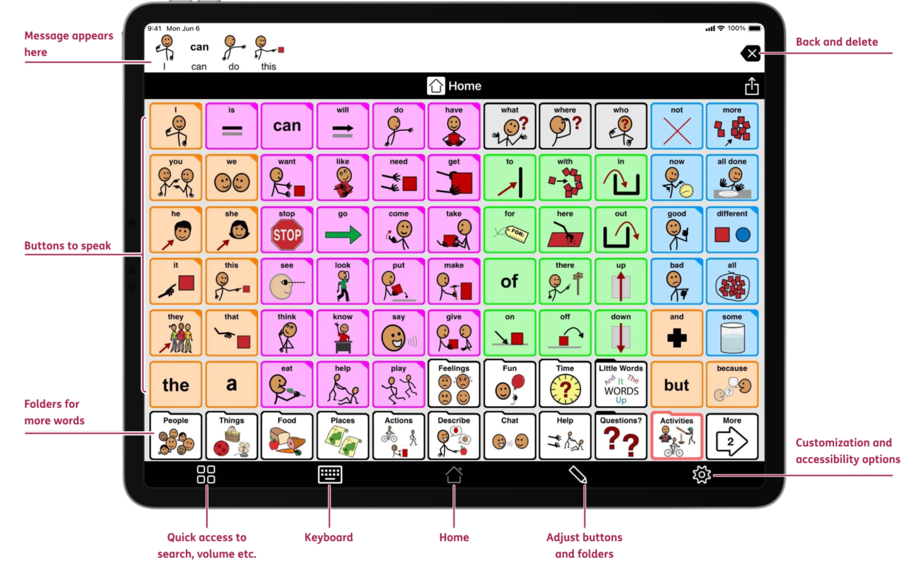  
*Figure 1: Proloquo2go User Interface*

Using the same app, the student at the barista station utilises it to display instructions and listens to the text-to-speech function.

Based on our interview(Appendix B) with the job coach of the F&B lesson, we learnt that one common issue faced is that when something unexpected happens, students become quiet or stop. Others ask for help but cannot specify what went wrong. For example, they are not able to verbalise that a coffee machine did not dispense after pressing the button. The coach also described difficulty reusing a strategy and a need to consider multiple responses. Teachers already break down scenarios, but the amount of practice depends on the class and the foundational skills students are working on. Staff also described the current workflow as consolidating informal observations into end-of-semester assessments rather than consistent, structured tracking of each student’s progress across teachers and classes

Similar difficulties are documented outside AWWA. The CNA documentary series *work.able* follows students with special needs as they transition from school to employment (CNA Insider, 2021). In one episode, a student was asked an open-ended customer-service question and remained silent for several minutes, despite knowing the menu. The professional featured in the episode attributed this to the student's reliance on structure: an unfamiliar, unscripted situation caused significant stress and disrupted his response (13:25-14:25). This mirrors the job coach's observation that some students "will keep quiet and not know what to do next". Both sources suggest that the difficulty lies less in task knowledge than in responding when a situation departs from routine.

## 2.2 Root Cause Analysis

A picture schedule shows how to make the drink. When the machine fails to dispense it, the learner needs to notice what changed, decide what to do and communicate the problem.

We identified that students have **limited opportunities to practise responding to changes in familiar tasks with support they can use**. The coach described mostly predictable routines. With few examples, students may struggle to see that asking for clarification can work across tasks. Teachers currently consolidate informal observations at semester end, so we also want to record which decisions students made and what guidance they needed.

Using the 5W method in Table 1 below, we framed the problem to further analyse it.

| Question | Answer  |
| ----- | ----- |
| Who | F&B students aged 16–18 with autism at AWWA, and the teachers who train them |
| What | Students stall or cannot respond when a workplace task deviates from the routine |
| When | At unplanned moments: wrong payment, machine fault, open-ended customer question |
| Where | In vocational lessons now; in supported or open employment after age 18 |
| Why | Training rehearses fixed sequences; there is little structured, repeatable practice of deviations |

*Table 1: 5Ws Analysis of the Root Cause*

One study reported gains in flexibility and problem solving after explicit teaching with visual cues and guided practice (Kenworthy et al., 2013). In another study, four autistic adolescents used a taught strategy on untrained vocational tasks (Lora et al., 2020). These studies gave us a reason to teach and assess transfer. At AWWA, uncertainty, communication demands and difficulty shifting plans may contribute alongside limited practice with variations. The interview left open whether engagement played a role. To investigate this, we will compare what learners do in a familiar routine with what they do when one event changes.

## 2.3 Existing Vocational Training Approaches

In Singapore, various special education institutions have adopted structured and technology-assisted approaches to vocational training. MINDS incorporates practical vocational education in sectors such as retail, hospitality and F&B, alongside authentic work attachments and digital learning technologies (MINDS, n.d.). Similarly, APSN Centre for Adults emphasises hands-on vocational training through specialised programmes, job trials and supported employment, with initiatives such as Café for All providing opportunities for authentic workplace practice (APSN, n.d.). Metta School also offers vocational certification and employment preparation pathways, incorporating workplace training and job coaching (Metta Welfare Association, n.d.).

The integration of technology into vocational training is supported by emerging research. A systematic review of 40 studies found that video-based interventions were promising for teaching employment-related skills to individuals with autism and intellectual disabilities, with video prompting commonly used for technical tasks and video modelling for social skills (Vallecillo et al., 2025). Similarly, a systematic review by Abd Aziz et al. (2026) highlighted the potential of video modelling to support the acquisition of structured vocational skills among autistic learners. However, the review also emphasised that successful skill acquisition does not necessarily translate into generalisation across unfamiliar environments, highlighting the importance of explicit practice across varied contexts.

While existing approaches demonstrate the value of structured instruction, simulation and authentic workplace exposure, there remains an opportunity to explore how these methods can be combined to support responses to unexpected situations during vocational tasks. This is particularly relevant to AWWA, where preliminary discussions with a job coach identified difficulties among some students in recognising problems, communicating challenges and applying previously learnt strategies to unfamiliar situations. Hence, the proposed project seeks to complement existing vocational training by providing structured, repeatable and adaptable scenario-based practice that explicitly targets problem-solving in unexpected workplace situations.

# 3 Objectives, scope and design specifications

## 3.1 Learning Objectives

Our design question is: How might we design a scalable and easy to maintain learning tool for vocational training, in order for teachers to build and track students’ agency, self-regulation, and problem-solving skills so that they are better prepared for unexpected situations in the workplace?

We define agency as choosing a suitable action, including asking for help. Self-regulation means recognising a need for a break, using an agreed support and deciding when to resume. Self-advocacy means explaining what happened or requesting clarification, help or a break through the student’s usual communication mode. Teachers need to be able to review the decisions and prompts so they know what to practise next.

## 3.2 Scope 

We started with the café cashier station we observed and introduced one change at payment. Starting with a single station gave us a manageable way to test how a student responds when the routine changes. The next version will focus on interactions such as clarifying an order or responding to an unavailable item. We aim to deliver a proof of concept that teachers can configure and use on school iPads. The interim evaluation focuses on these tasks, with employment and long-term workplace performance beyond its scope.

## 3.3 Design specifications

We used secondary research to develop an initial user needs table, then asked the AWWA job coach to identify and rank the needs the prototype should address. The coach ranked recognising and breaking down a problem first, followed by describing the problem when seeking help, applying the same approach in other situations, and considering possible responses. The teacher-side priorities, in order, were tracking individual student progress, adapting practice to learners’ needs, and maintaining the system after handover. The table was then revised to the one shown below as Table 2, which shows how the field evidence informed the design specifications.

| Rank (most \-\> least important)  | User needs | Selected framework | App features | Secondary research |
| :---- | :---- | :---- | :---- | :---- |
| S1 | Identify and break down the problem.  *Job Coach: “When hit with an unexpected situation, teachers observe that “students tend to be stunned and are not sure what to do next”* | **PCTL step 1**: Help the student notice and describe what is wrong in a familiar work scenario. Use the person’s usual communication mode and concrete cues. **PCTL step 2**: Break the situation into smaller parts and locate the step or condition causing difficulty.  | Break the routine into short, visible steps. Show what has changed when a problem occurs and use a visual cue to direct attention to the affected step or next action. Include option to temporarily pause and return to task | The PCTL model includes identifying and subdividing problems as problem-solving dimensions. The model was developed for children with intellectual disabilities and evaluated by experts (Kantathanawat et al., 2025d). NCSE autism guidance recommends individualised visual supports, clear task expectations and sequencing (NCSE, 2026). A vocational training study used a written activity schedule to teach a strategy for handling disruptions in vocational tasks (Lora et al., 2020). An adapted problem-solving study described slowing down before responding as part of an adapted problem-solving programme for people with intellectual disabilities (Ailey et al., 2012b). |
| S2 | Verbalising the problem when seeking help *Job coach: “When hit with an unexpected situation, teachers observe that some students may ask for help but struggle with verbalising what they need help with.”* | **PCTL step 4**: compare the options, choose an appropriate action, and communicate it. Help-seeking is one valid response; adapt the form to the learner. | Provide a short template for naming the task, describing the problem and requesting assistance. Gradually fade prompts and allow responses through speech, pointing, pictures, typing or prolog.  | A vocational help-seeking study used scripts and script fading to teach four autistic adolescents to describe problems and request assistance in simulated vocational tasks. (Dotto-Fojut et al., 2010b) CAST recommends offering multiple means of expression and communication (CAST, Inc., n.d.-b). A help-request study taught three autistic children to request help when they could not complete a task step independently. During initial teaching, requests also carried over to some steps the children could complete on their own (Rodriguez et al., 2017). |
| S3 | Knowing how to apply the same approach in other situations *Job coach: “Some of them may not be able to see or generalize that this (strategy) can actually be used for a different situation”* | **PCTL step 5:** check whether the action worked, learn from the result, and practise the same reasoning in a different situation. | Keep the same sequence across a routine tutorial and a challenge with a changed condition.  Vary the practice materials and prompt learners to check whether their response resolved the problem. | A vocational training study taught four autistic adolescents a structured strategy for dealing with problems in vocational tasks and reported generalisation to untaught tasks (Lora et al., 2020). A social problem-solving study used a separate task to assess generalisation of social problem-solving skills in autistic young people (Bonete et al., 2022b). PCTL includes evaluating outcomes and adapting the response as the final dimension of PCTL (Kantathanawat et al., 2025b). |
| S4 | Generating possible responses after analysing the problem *Job coach: “...so at least they know that one problem (does) not just (have) one problem-solving method), there’s multiple (problem-solving methods) they can actually use and apply.”* | **PCTL step 3**: connect the cause or need to more than one possible response. Teach a repeatable social problem-solving routine while preserving room for student-generated ideas. | Prompt learners to choose and practise an appropriate action after identifying the problem.  Allow teachers to accept suitable wording that differs from the example.  Ask learners to generate and compare distinct actions. | A social problem-solving study taught autistic learners a social problem-solving routine that included generating alternative responses and considering their outcomes (Suarez et al., 2021d). PCTL includes generating and evaluating responses and checking outcomes as dimensions of PCTL (Kantathanawat et al., 2025b). A vocational help-seeking study taught describing the problem and requesting assistance as a response to simulated work difficulties (Dotto-Fojut et al., 2010c). |
| T1 | Teacher need: track individual student progress over a period of time *Job coach: “if we can use an app (to track), then it will reduce our mental load and makes the work less stressful”* |  | Provide a teacher summary after each practice session showing the learner’s response, the support they used and the outcome.  Save individual summaries for comparison across sessions. | A review of feedback research found that feedback effectiveness depends on its type and how it is delivered. The review distinguishes feedback on task performance, the process used and self-regulation (Hattie & Timperley, 2007). A validation study found support for the four dimensions of the Career Adapt-Abilities Scale–Short Form in students with special educational needs: concern, control, curiosity and confidence (Yang et al., 2023b). SG Enable’s Enabling Skills and Competencies Framework describes three progression levels and includes adaptability and communication and self-advocacy (Ernst & Young, 2024). Both cover broader development than a single practice task. |
| T2 | Adapt scenarios and options to differing abilities of students and industry needs *Teachers actively change teaching methods and content based on the ability of each class (simplification of tasks for lower-functioning students/students with behavioural or sensorial needs)*  |  | Let teachers choose practice materials and adjust prompt levels.  Offer picture and audio cues, a feelings check-in and a pause option. | NCSE autism guidance recommends individualised visual supports and adapting teaching to learners’ needs (NCSE, 2026b). A vocational help-seeking study used script fading during simulated vocational tasks (Dotto-Fojut et al., 2010c). An adapted problem-solving study described slowing down before responding as part of a problem-solving programme adapted with people with intellectual disabilities and their staff (Ailey et al., 2012c). |
| T3 | Maintaining of system after project handover *Job coach agrees that this is important.* |  | Provide school-managed access, editable scenarios, handover documentation, and appropriate export and backup controls. | The Principles for Digital Development recommend planning for long-term ownership, maintenance and capacity building. They also identify knowledge transfer and secure data transfer or deletion as considerations at the end of a project (Build for Sustainability – Principles for Digital Development, n.d.). |

*Table 2: Revised user-needs table after interview with job coach*

# 4 Concept development and evaluation

## 4.1 Problem-solving Framework: Why PCTL

We compared three frameworks based on how they help learners recognise a problem, choose a response, check whether it worked, and apply the same approach in a new situation. We also considered how closely each framework matched the teaching approach described by the job coach, presented in Table 3 below.

| Framework | Relevant strengths | Role in our design |
| :---- | :---- | :---- |
| **PCTL** | Starts with a concrete situation and guides learners to identify and break down the problem, consider responses, and check the outcome. | Provides the main teaching sequence for practising and transferring problem-solving skills. |
| **ADAPT** | Encourages learners to pause, define the problem, generate alternatives, and consider what might happen before trying a response. | Informs self-regulation supports, such as pausing before responding. |
| **Social problem-solving** | Helps learners interpret social cues and consider possible responses and their consequences. | Informs scenarios such as an unclear order or a changed customer request. |

*Table 3: Comparison of problem-solving frameworks*

We chose PCTL because it most closely matched how AWWA teaches problem-solving. The job coach described starting with a concrete scenario, breaking it down to identify the skills students need, demonstrating what to do, and giving students a chance to practise through role-play. PCTL combines learning through concrete situations, cognitive coaching, task analysis, and a supportive learning environment. Its emphasis on breaking a problem into manageable steps and guiding learners through a response fits AWWA’s approach to vocational practice (Appendix A).

PCTL was developed for children with intellectual disabilities. Eight educational experts rated its overall appropriateness at 4.40 out of 5 (SD \= 0.51) (Kantathanawat et al., 2025). In a separate vocational study of a related approach, four autistic adolescents used a written activity schedule to handle disruptions such as missing or broken items. All four achieved 100% correct responses across two consecutive sessions, applied the strategy to untrained scenarios, and maintained mastery at two- and four-week follow-ups with the schedule available (Lora et al., 2020).

Related studies informed specific teaching choices. ADAPT-informed research described pausing before responding (Ailey et al., 2012). In a worksheet-based study, three autistic participants learnt a structured problem-solving strategy and resolved untrained social conflicts during assessments in natural settings (Suarez et al., 2021b). In simulated vocational tasks, four autistic adolescents learnt to describe a work problem and request assistance using scripts and gradually reduced prompts (Dotto-Fojut et al., 2010). The effectiveness of the adapted PCTL sequence with AWWA learners has yet to be tested.

## 4.2 Evaluation of Alternative Learning Concepts

Our early work assumed a digital tool. Following feedback at the interim presentation, we compared alternative formats systematically. We shortlisted only formats that match evidence-based practices for autistic learners and compared the advantages and limitations of each concept. These come from the National Clearinghouse on Autism Evidence and Practice (NCAEP), which reviewed 972 studies of autistic individuals under 22 years old (Steinbrenner et al., 2020).

Four approaches were shortlisted, each corresponding to an NCAEP evidence-based practice in brackets and each offering a different way to practise. In **video modelling (Video Modelling)**, the student watches someone handle the situation and then copies it. In **teacher-led role-play (Social Skills Training and Modelling)**, the student acts the situation out with a teacher or peer and receives feedback. **Social stories (Social Narratives)** let the student read an illustrated account of what to do. A **digital app (Technology-aided Instruction and Intervention)** has the student work through interactive scenarios with prompts.

We also considered three other formats but did not shortlist them. Physical card games have no evidence base of their own in the NCAEP review. VR simulation is costly and heavy on sensory input, and it does not run on AWWA's iPads. Real workplaces cannot safely stage problems for students to practise again and again. 

For the shortlisted formats, the advantages and limitations were identified in Table 4 below  based on the needs and design specifications in Sections 2.2 and 3.3. 

| Format | Advantages | Limitations |
| ----- | ----- | ----- |
| **Video modelling** | Strongest evidence base; consistent and predictable; can be replayed | Watching, not practising; shows one fixed response; no progress records |
| **Teacher-led role-play** | Most realistic and social; adaptable in the moment; uses props | Needs teacher time; varies between runs; hard to repeat or record; being watched may cause stress |
| **Social stories** | Calm, predictable preparation; low cost; easy to personalise | Passive (reading, not responding); one story per situation; no feedback or tracking |
| **Digital app** | Repeatable, self-paced; consistent; varied scenarios; adjustable prompts; records progress; runs on iPads | Less realistic and social; may not carry over to real tasks on its own; needs maintenance |

*Table 4: Comparison of Learning Concepts*

Evidently, there is no single approach which meets every need. The digital app best addresses the two root causes in Section 2.2, uncertainty and limited chances to practise. It offers consistent, repeatable practice of unexpected situations, and teachers can adjust support and track progress. Role-play remains stronger for realism and social interaction. Video modelling and social stories provide consistent input but little active practice. Both also present one fixed way of responding, which works against the job coach's aim of showing students that one problem can be solved in several ways.

We therefore chose a hybrid, combining formats so that each covers the others' weaknesses. The app sets up the unexpected situation, guides the student through the PCTL steps with visual cues and adjustable prompts, and records progress. At the same time, physical props and teacher role-play keep practice hands-on and social. These include order cards and play money.

Because the app is purpose-built to teach problem solving, it counts as Technology-aided Instruction under NCAEP's definition. It also draws on two other evidence-based practices: Visual Supports and Prompting. The hybrid also fits PCTL, which relies on a teacher coaching the student: the app supports the teacher rather than replacing them.

## 4.3 Development platform

After evaluating our possible solution formats, we considered various development platforms for our digital-based solution. At the same time, we decided to use Codex to help us with rapid prototyping for the interim stage. 

Prototype V1 was built with Codex to test the features before we committed to a platform. For the final tool, we compared three development platforms, Unity, GDevelop and H5P against criteria taken from our design specifications, especially T3: the tool must run on AWWA's iPads and teachers must be able to maintain it after handover.

After a few rounds of testing and feedback based on the prototypes we made with Codex together with the evaluation matrix in Table 5, with the full scores and reasoning under Appendix C, we chose GDevelop for future prototyping. It is the only option that both simulates hands-on tasks and runs in iPad Safari without coding, and teachers can still adjust settings themselves. Unity has the strongest evidence in autism, from ShopAut (Vallefuoco et al., 2022\) and a restaurant social-skills game (Bahiss, 2021). However, it needs coding skills and a paid Apple account to run on iPads, which would make it hard for AWWA to maintain. H5P is the easiest for teachers to edit, but it cannot simulate hands-on tasks and has limited progress tracking.

The main trade-off is that teachers can change GDevelop's settings, such as prompt levels and food items, but cannot build new scenarios without our help.

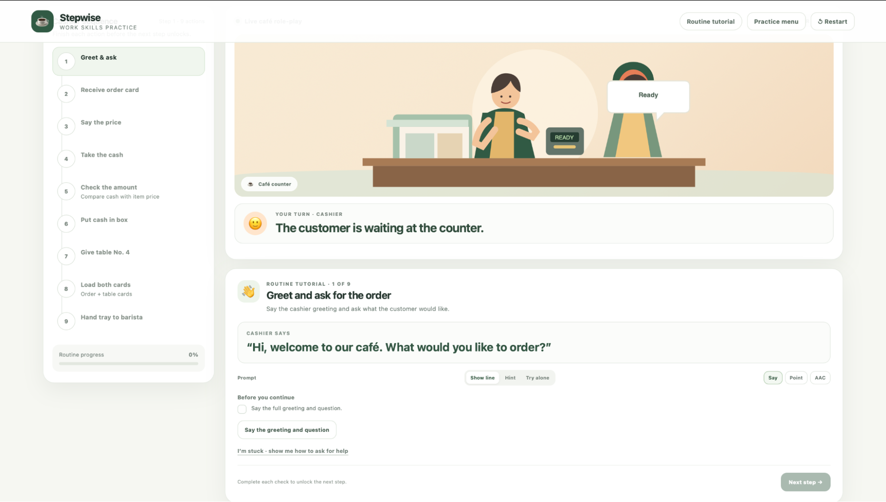

*Figure 2: Weighted Comparison Matrix for Different Development Platforms*

## 4.4 Principles behind each feature

Each feature of the app responds to a need identified in Section 3.3 and is grounded in an established teaching practice for autistic learners. Most draw on practices that the NCAEP review identifies as evidence-based (Steinbrenner et al., 2020). Table 5 links each feature to its underlying principle and supporting evidence. It also notes where a principle could work against learners, such as prompt dependency or anxiety from too much variation, and how the design manages this.

| Feature | Principle | Evidence (autism-specific) | Possible conflict and how to handle it |
| ----- | ----- | ----- | ----- |
| **Picture-card layout** | Visual supports | Visual Supports is an evidence-based practice (Steinbrenner et al., 2020\) | – |
| **Small steps** | Task analysis | Task Analysis is an evidence-based practice (Steinbrenner et al., 2020\) | – |
| **Show line / Hint / Try alone** | Prompting, prompt fading | Prompting is an evidence-based practice (Steinbrenner et al., 2020); prompt-fading procedures are generally effective (Cengher et al., 2018\) | Prompt dependency → fade levels over sessions |
| **Varied items and amounts** | Generalisation training | Multiple-exemplar training produced generalisation of social skills in autistic 13–30-year-olds (Erhard et al., 2024\) | Too much variation causes anxiety → change one thing at a time |
| **Check-in and pause** | Self-management, emotional regulation | Self-Management is an evidence-based practice (Steinbrenner et al., 2020\) | – |
| **Physical props** | Transfer from screen to real task | Most technology-based social skills studies reported generalisation to real-world settings (Mosher et al., 2022\) | Screen-only practice may not transfer → hybrid |
| **Text-to-speech, AAC option** | Augmentative communication | AAC is an evidence-based practice (Steinbrenner et al., 2020\) | Verbal-only scoring excludes non-verbal students → alternative responses |

*Table 5: Principles behind each feature*

# 5 Prototyping

## 5.1 Purpose of Semester 1 Prototype

At the interim stage, our Codex prototypes explore the feasibility of translating the identified user needs and design requirements into an interactive vocational training platform. The prototype serves as a proof of concept for a digital learning tool that enables students with autism to practise vocational tasks and respond to unexpected workplace situations within a structured and supportive environment. This preliminary prototype is not designed to demonstrate improvements in students' problem-solving abilities. Instead, it helped identify interface and navigation difficulties that informed further development.

## 5.2 Initial Prototype (V1)

The prototype focuses on a café cashier scenario, adapted from the F&B vocational training lesson observed at AWWA on 18 September. The routine task we picked was based on one of the three stations of the lesson, namely, the station where the student role plays as the cashier. We intended to translate what we saw into our prototype features while still maintaining the key idea of the lesson activity. The digital learning tool follows a **Learn–Practice–Apply** approach, where students are first guided through a routine task, adapted from the current lesson structure, before practising their responses to unexpected situations through interactive challenges. Features such as visual instructions, adjustable prompts and teacher controls were incorporated to accommodate different learning needs.

## 5.3 First Iteration

We received feedback from our supervisors after running through the initial prototype with them and organised the changes we made in Table 6, together with the rationale for the change.

| Design focus | Improvements made | Rationale |
| :---- | :---- | :---- |
| Accessibility | Larger text, clearer visuals, text-to-speech | Reduce reading demands and improve clarity of instructions |
| Communication | Voice recording and teacher verification | Allow students to practise verbal responses and receive feedback |
| Self-regulation | Emotional check-in | Help students communicate their emotional state before beginning |
| Adaptability | Adjustable prompts and task variations | Accommodate different support needs and reduce reliance on memorised responses |
| Teacher monitoring | Session performance summary | Allow teachers to review students' progress and support needs |
| Real-world relevance | Physical props | Reinforce connections between simulated tasks and hands-on vocational practice |

*Table 6: Improvements made to initial prototype*

These refinements were guided by the identified student and teacher needs, with an emphasis on improving accessibility, adaptability and the relevance of the learning experience. In particular, simplifying the interface and incorporating multimodal instructions aimed to reduce the cognitive demands associated with navigating the prototype (Figure 3 and 4). Meanwhile, adjustable prompt levels and task variations were introduced to accommodate differing student abilities and encourage independent problem-solving rather than memorisation of routine responses. Teacher-facing features were also incorporated to facilitate the monitoring of student performance and enable more personalised learning experiences.  
  
*Figure 3: Initial Codex Prototype V1*

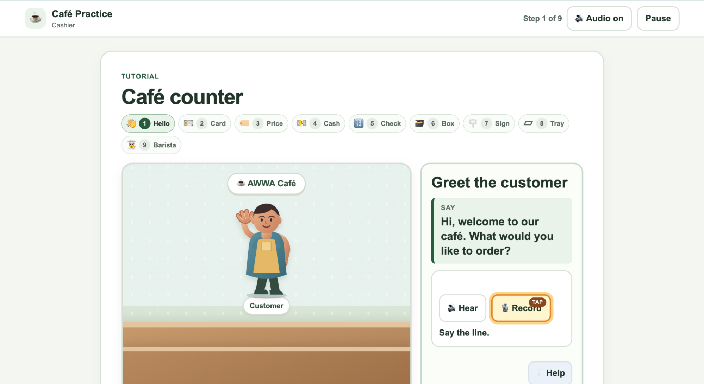  
*Figure 4: Refined V1 with improvements made*

## 5.4 Prototype V2

After the revised V1 trial, we used a simpler picture-card layout and clearer action cues in V2. We spotlighted the active panel and used animated arrows to show the next button. The teacher override lets staff accept an appropriate spoken response that differs from the sample wording. The pause option lets a learner take a break. These are design responses to navigation, communication and regulation needs. In Section 7 we propose comparing the moving cues and spotlighting with a static yellow highlight. Appendix D shows screenshots from the interim presentation.

# 6 Testing and results

## 6.1 Informal trial of revised V1

One of our family members with autism tried the revised V1 after the initial changes. We used the cashier activity and observed whether he could follow the sequence, recognise the next action, and use the supports (Table 7). We also checked whether the recording interaction could be used. The trial was informal, and we provided guidance as needed. It aimed to uncover usability issues before a school pilot.

| Observation | Interpretation and design response |
| :---- | :---- |
| The participant went through the scenario, and the physical money appeared to help him understand the task. | Continue complementary use of hardware with the platform. |
| He read all the screen text before acting and needed help identifying the next button, even with highlighting. | Reduce competing text and make the current action more distinct. Check whether the revised cue is effective. |
| He was able to use speech recording and his speech was detected during the session. | Keep speech recording and detection.  |

*Table 7: Observations and Interpretation of Informal Trial of Revised V1*

Some limitations would be that the same observations can have several explanations. Reading every word may reflect his way of approaching the interface, and help with navigation may mask what he understood about the scenario. The trial involved one family member with different support needs, and we recorded neither a baseline nor standardised prompt counts. We used the observations to guide interface changes.

## 6.2 Stakeholder review of V2

Prototype V2 was presented to the principals and teachers of AWWA Napiri and Bedok schools on 21st October to gather stakeholder feedback on its suitability for vocational training and identify areas for further improvement. Overall, stakeholders responded positively to the structured learning modules, emotional check-in activity and customisable prompt levels, which were viewed as useful features for supporting students with varying learning needs.

The feedback highlighted three key areas for refinement. Firstly, stakeholders emphasised the importance of **social skills development**, recommending that the learning scenarios prioritise realistic customer interactions over manual calculations. Suggested scenarios included responding to customer enquiries, providing recommendations and managing situations where students are unable to understand or hear customers clearly. These scenarios would provide more opportunities for students to practise communication and problem-solving in unpredictable workplace situations.

Secondly, **inclusive accessibility** was identified as an important consideration, particularly for non-verbal students who make up the majority of students at AWWA. Stakeholders recommended incorporating alternative communication methods beyond voice recording, such as text-to-speech functionality, to accommodate students with different communication abilities.

Lastly, stakeholders highlighted the importance of **emotional self-regulation** when students encounter challenging or overwhelming situations. A pause function was proposed to allow students to temporarily stop the activity, reflect on their emotional state and resume when ready. Maintaining a consistent interface with the initial emotional check-in activity was also recommended to promote familiarity.

Overall, the feedback reinforced the relevance of the proposed learning approach while identifying improvements needed to better accommodate AWWA students' diverse abilities and vocational learning needs. These recommendations will guide subsequent prototype refinements and inform future usability testing with the intended student population.

# 7 Problems, shortcomings and plan

## 7.1 Shortcomings and Proposed Resolution

The Semester 1 work established usability and stakeholder fit, but did not measure learning. Table 8 summarises the main shortcomings and how we will address them.

| Shortcoming | Proposed resolution |
| ----- | ----- |
| Tested with only one participant, who is higher-functioning | Pilot with AWWA students aged 16-18 across support needs in Jan–Feb |
| No learning outcomes measured yet | Evaluation plan in 7.2 |
| Voice-only responses exclude non-verbal students | Picture or AAC response options; text-to-speech on every step |
| Scenario stresses calculation, but AWWA prioritises social interaction | Add customer-interaction scenarios: recommendations, mishearing, feeling overwhelmed |
| Codex prototype is not maintainable after handover | Rebuild as V3 in GDevelop; teachers edit settings |

*Table 8: Shortcomings and Proposed Resolutions*

## 7.2 Evaluation plan

The Semester 2 pilot will test whether practising with the tool helps students respond to unexpected situations, and whether this carries over beyond the app. We hypothesise that after three to four practice sessions, students will need less prompting to resolve an unexpected event, including in an unseen role-play.

Three to five students from the F&B cohort aged 16-18 will take part, with parental consent and student assent obtained through AWWA, subject to their availability. Each student will complete a baseline role-play, four app practice sessions and a post-test (Table 9). At each of five steps (notice, locate, choose, communicate, check), the observer will record the least support needed, from independent (3) to modelled response (0), giving a scenario score out of 15\. Appendix E shows the scoring table and the full details.

| Phase | Task | Purpose |
| ----- | ----- | ----- |
| Baseline (before app use) | Teacher-led role-play with one unexpected event | Establish each student’s starting level |
| Practice (sessions 1–4) | App scenarios with varied items and amounts | Track change during practice |
| Post-test | Unseen app scenario, plus a role-play with changed details | Measure learning and carry-over |

*Table 9: Evaluation Phases*

The tool will be judged effective if most students improve by at least 3 points from baseline to post-test, perform similarly on the unseen role-play, and need fewer than two navigation prompts per session by session 3\. With a small sample, results will be compared student by student rather than statistically. 

# 8 Conclusion

Semester 1 established the problem, the approach and an initial prototype. Evidence from AWWA staff and research points to uncertainty, communication demands and limited practice with variation as likely contributors, which suggests a need for structured, repeatable practice of unexpected situations. The hybrid design addresses this while fitting AWWA’s existing iPad-based teaching. Testing so far shows that the prototype is usable and relevant, but it has not yet shown that students learn from it. Semester 2 will therefore focus on three priorities: adding customer-interaction scenarios and non-verbal response options, piloting the tool with AWWA students, and handing over a maintainable version to the school.

# 9 References

Abd Aziz, N., Nurja, N. A., Abu Hassan, H., Masnan, A. H., Hosshan, H., Abdul Razak, N. S. R., Abdul Jabar, S., Ismail, N. K., Ibrahim, I., Angelov, D., & Rahmahtrisilvia. (2026). Video modelling interventions in autism education: A systematic review. *Social Sciences, 15*(6), Article 376\. [https\://doi.org/10.3390/socsci15060376](https://doi.org/10.3390/socsci15060376)

Ailey, S. H., Friese, T. R., & Nezu, A. M. (2012). Modifying a social problem‐solving program with the input of individuals with intellectual disabilities and their staff. Research in Nursing & Health, 35(6), 610–623. [https\://doi.org/10.1002/nur.21497](https://doi.org/10.1002/nur.21497)

Association for Persons with Special Needs. (n.d.). *APSN Centre for Adults*. [https\://www\.apsn.org.sg/apsn-centre-for-adults/](https://www.apsn.org.sg/apsn-centre-for-adults/)

AWWA. (2024, September 24). *Transition Planning Department*. [https\://awwa.org.sg/our-services/awwa-school/transition-planning-department/](https://awwa.org.sg/our-services/awwa-school/transition-planning-department/)

AWWA Ltd. (2026). *Progressing care: Annual report 2025–2026*. [https\://awwa.org.sg/wp-content/uploads/2026/09/AWWA-Annual-Report-FY2526.pdf](https://awwa.org.sg/wp-content/uploads/2026/09/AWWA-Annual-Report-FY2526.pdf)

Bahiss, K. (2021). *A serious game to provide social skills training for people with Asperger’s syndrome/high-functioning autism* \[Doctoral thesis, The University of Waikato\]. [https\://hdl.handle.net/10289/14222](https://hdl.handle.net/10289/14222)

Bonete, S., Molinero, C., & Garrido-Zurita, A. (2022b). Generalization Task for Developing Social Problem-Solving Skills among Young People with Autism Spectrum Disorder. Children, 9(2), 166\. [https\://doi.org/10.3390/children9020166](https://doi.org/10.3390/children9020166)

Build for sustainability – Principles for Digital Development. (n.d.). [https\://digitalprinciples.org/principles/build-for-sustainability/](https://digitalprinciples.org/principles/build-for-sustainability/)

CAST, Inc. (n.d.-c). Action & expression. CAST UDL Guidelines. [https\://udlguidelines.cast.org/action-expression](https://udlguidelines.cast.org/action-expression)

Cengher, M., Budd, A., Farrell, N., & Fienup, D. M. (2018). A review of prompt-fading procedures: Implications for effective and efficient skill acquisition. *Journal of Developmental and Physical Disabilities, 30*, 155–173. [https\://doi.org/10.1007/s10882-017-9575-8](https://doi.org/10.1007/s10882-017-9575-8)

CNA Insider. (2021). Life With Special Needs: Am I Different? \| Work.Able \| Part 1/6 YouTube.[https\://www\.youtube.com/watch?v=5JOBZj6A65w&t=875s](https://www.youtube.com/watch?v=5JOBZj6A65w&t=875s)

Davies, J., Romualdez, A. M., Pellicano, E., & Remington, A. (2024). Career progression for autistic people: A scoping review. *Autism, 28*(11), 2690–2706. [https\://doi.org/10.1177/13623613241236110](https://doi.org/10.1177/13623613241236110)

Dotto-Fojut, K. M., Reeve, K. F., Townsend, D. B., & Progar, P. R. (2010). Teaching adolescents with autism to describe a problem and request assistance during simulated vocational tasks. Research in Autism, 5(2), 826–833. [https\://doi.org/10.1016/j.rasd.2010.09.012](https://doi.org/10.1016/j.rasd.2010.09.012)

Erhard, P., Falcomata, T. S., Oshinski, M., & Sekula, A. (2024). The effects of multiple-exemplar training on generalization of social skills with adolescents and young adults with autism: A systematic review. *Review Journal of Autism and Developmental Disorders, 11*(1), 66–85.

Ernst & Young. (2024). Enabling Skills and Competencies Framework (Persons with Disabilities). [https\://www\.sgenable.sg/docs/default-source/for-ea/ealf---escf-files/enabling-skills-and-competencies-framework-(persons-with-disabilities)\_vf\_7oct.pdf](https://www.sgenable.sg/docs/default-source/for-ea/ealf---escf-files/enabling-skills-and-competencies-framework-\(persons-with-disabilities\)_vf_7oct.pdf)

Hattie, J., & Timperley, H. (2007). The power of feedback. *Review of Educational Research, 77*(1), 81–112. [https\://doi.org/10.3102/003465430298487](https://doi.org/10.3102/003465430298487)

Jenkinson, R., Milne, E., & Thompson, A. (2020). The relationship between intolerance of uncertainty and anxiety in autism: A systematic literature review and meta-analysis. *Autism, 24*(8), 1933–1944. [https\://doi.org/10.1177/1362361320932437](https://doi.org/10.1177/1362361320932437)

Kantathanawat, T., Treearpornwong, A., & Charoentham, M. (2025). Development of a problem-solving ability learning model for children with intellectual disabilities. Journal of Education and Health Promotion, 14(1), 179\. [https\://doi.org/10.4103/jehp.jehp\_13\_25](https://doi.org/10.4103/jehp.jehp_13_25)

Kenworthy, L., Anthony, L. G., Naiman, D. Q., Cannon, L., Wills, M. C., Luong‐Tran, C., Werner, M. A., Alexander, K. C., Strang, J., Bal, E., Sokoloff, J. L., & Wallace, G. L. (2013). Randomized controlled effectiveness trial of executive function intervention for children on the autism spectrum. Journal of Child Psychology and Psychiatry, 55(4), 374–383. [https\://doi.org/10.1111/jcpp.12161](https://doi.org/10.1111/jcpp.12161)

Lora, C. C., Kisamore, A. N., Reeve, K. F., & Townsend, D. B. (2020). Effects of a problem-solving strategy on the independent completion of vocational tasks by adolescents with autism spectrum disorder. *Journal of Applied Behavior Analysis, 53*(1), 175–187. [https\://doi.org/10.1002/jaba.558](https://doi.org/10.1002/jaba.558)

Metta Welfare Association. (n.d.). *Special education*. [https\://www\.metta.org.sg/special-education/](https://www.metta.org.sg/special-education/)

Ministry of Manpower. (2024). *Labour force in Singapore: Advance release 2024*. [https\://www\.mom.gov.sg/newsroom/press-releases/2024/1128-labour-force-in-singapore-advance-release-2024](https://www.mom.gov.sg/newsroom/press-releases/2024/1128-labour-force-in-singapore-advance-release-2024)

Ministry of Social and Family Development. (2024, September 16). *Enabling Masterplan 2030 update: New plans to bolster inclusive employment and community living opportunities for persons with disabilities*. [https\://www\.msf.gov.sg/media-room/article/enabling-masterplan-2030-update-new-plans-to-bolster-inclusive-employment-and-community-living-opportunities-for-persons-with-disabilities](https://www.msf.gov.sg/media-room/article/enabling-masterplan-2030-update-new-plans-to-bolster-inclusive-employment-and-community-living-opportunities-for-persons-with-disabilities)

Mosher, M. A., Carreon, A. C., Craig, S. L., & Ruhter, L. C. (2022). Immersive technology to teach social skills to students with autism spectrum disorder: A literature review. *Review Journal of Autism and Developmental Disorders, 9*(3), 334–350. [https\://doi.org/10.1007/s40489-021-00259-6](https://doi.org/10.1007/s40489-021-00259-6)

Movement for the Intellectually Disabled of Singapore. (n.d.). *Special education schools*. [https\://www\.minds.org.sg/what-we-do/special-education/](https://www.minds.org.sg/what-we-do/special-education/)

NCSE. (2026b, April 9). Autism Good Practice Guidance for Schools \- NCSE. [https\://www\.ncse.ie/school-leaders/resources-for-school-leaders/autism-good-practice-guidance-for-schools/](https://www.ncse.ie/school-leaders/resources-for-school-leaders/autism-good-practice-guidance-for-schools/)

Petrolini, V., Jorba, M., & Vicente, A. (2023). What does it take to be rigid? Reflections on the notion of rigidity in autism. *Frontiers in Psychiatry, 14*, Article 1072362\. [https\://doi.org/10.3389/fpsyt.2023.1072362](https://doi.org/10.3389/fpsyt.2023.1072362)

Rodriguez, N. M., Levesque, M. A., Cohrs, V. L., & Niemeier, J. J. (2017b). Teaching children with autism to request help with difficult tasks. Journal of Applied Behavior Analysis, 50(4), 717–732. [https\://doi.org/10.1002/jaba.420](https://doi.org/10.1002/jaba.420)

SkillsFuture Singapore. (2023). *Skills demand for the future economy 2023/24*. [https\://www\.skillsfuture.gov.sg/skillsreport](https://www.skillsfuture.gov.sg/skillsreport)

Sofiah, A. (2023, April 13). *Most critical core skills to equip Singapore’s workforce with*. Human Resources Online. [https\://www\.humanresourcesonline.net/most-critical-core-skills-to-equip-singapore-s-workforce-with](https://www.humanresourcesonline.net/most-critical-core-skills-to-equip-singapore-s-workforce-with)

Steinbrenner, J. R., Hume, K., Odom, S. L., Morin, K. L., Nowell, S. W., Tomaszewski, B., Szendrey, S., McIntyre, N. S., Yücesoy-Özkan, S., & Savage, M. N. (2020). *Evidence-based practices for children, youth, and young adults with autism*. The University of North Carolina at Chapel Hill, Frank Porter Graham Child Development Institute, National Clearinghouse on Autism Evidence and Practice Review Team.

Suarez, V. D., Najdowski, A. C., Tarbox, J., Moon, E., St Clair, M., & Farag, P. (2021b). Teaching Individuals with Autism Problem-Solving Skills for Resolving Social Conflicts. Behavior Analysis in Practice, 15(3), 768–781. [https\://doi.org/10.1007/s40617-021-00643-y](https://doi.org/10.1007/s40617-021-00643-y)

Vallecillo, Y., Visitacion, K., Dyer, E., & Hockman, A. (2025). Video-based interventions for teaching individuals with disabilities employment skills: A systematic review. *Psychology in the Schools, 62*(12), 4702–4724. [https\://doi.org/10.1002/pits.70033](https://doi.org/10.1002/pits.70033)

Vallefuoco, E., Bravaccio, C., Gison, G., Pecchia, L., & Pepino, A. (2022). Personalized training via serious game to improve daily living skills in pediatric patients with autism spectrum disorder. *IEEE Journal of Biomedical and Health Informatics, 26*(7), 3312–3322. [https\://doi.org/10.1109/JBHI.2022.3155367](https://doi.org/10.1109/JBHI.2022.3155367)

World Health Organization. (2025, September 17). *Autism* \[Fact sheet\]. [https\://www\.who.int/news-room/fact-sheets/detail/autism-spectrum-disorders](https://www.who.int/news-room/fact-sheets/detail/autism-spectrum-disorders)

Yang, L., Sin, K. F., & Savickas, M. L. (2023b). Assessing factor structure and reliability of the career adaptability scale in students with special educational needs. Frontiers in Psychology, 14, 1030218\. [https\://doi.org/10.3389/fpsyg.2023.1030218](https://doi.org/10.3389/fpsyg.2023.1030218)

# 10 Appendix

* Appendix A: AWWA Lesson Observation on 18 September 2026  
* Appendix B: Job Coach Interview Transcript  
* Appendix C: Development Platform Evaluation Matrix Scores and Reasonings  
* Appendix D: Prototype V2 Screenshots  
* Appendix E: Evaluation Plan

## Appendix A: AWWA Lesson Observation on 18 September 2026

The senior F&B class used a visible schedule, safety reminders, illustrated instructions, physical cards and iPads. The notes describe cashier, barista and service tasks. Some learners used a prolog and others used physical communication cards. A single observed class informed the scenario and the presentation of instructions.

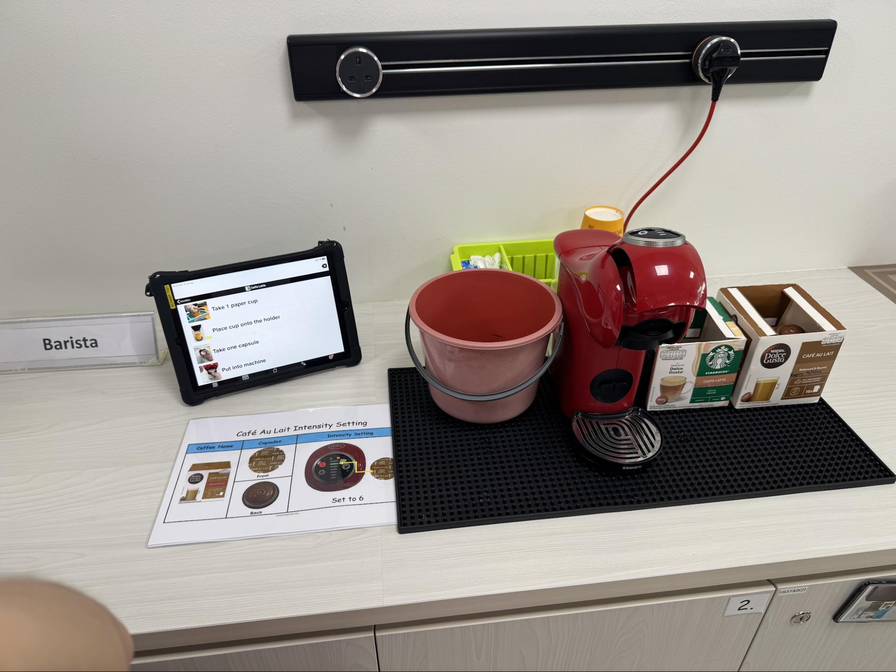  
Figure 5: Barista station featuring students using the Prolog on an iPad to follow the coffee-making steps. When they tap the next step, the app reads the instruction aloud.

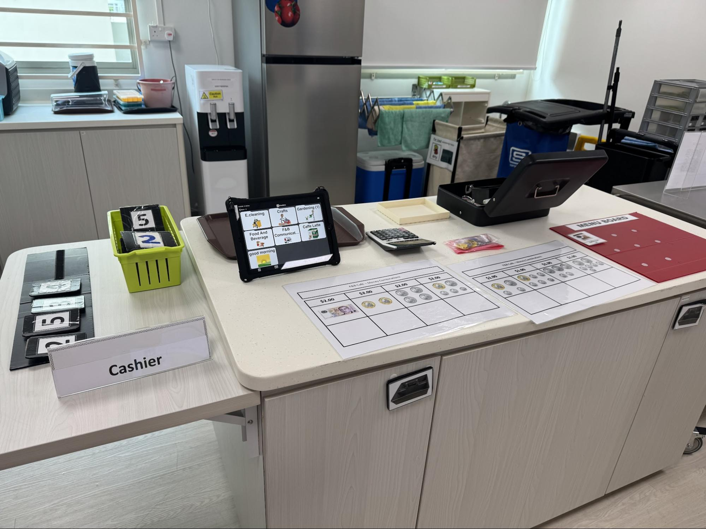  
Figure 6: Cashier station featuring the Prolog on the iPad used by non-verbal students to communicate as a customer or cashier. 

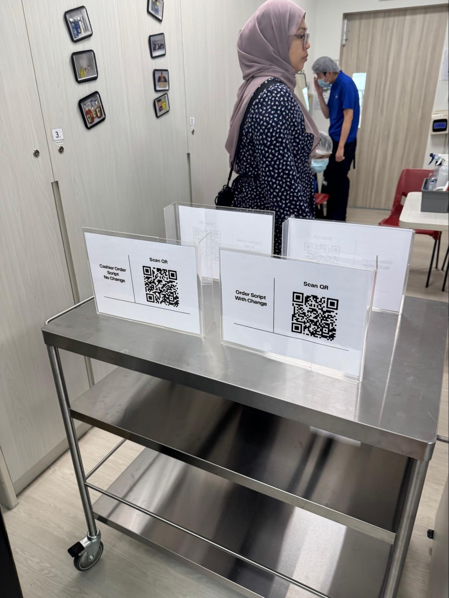
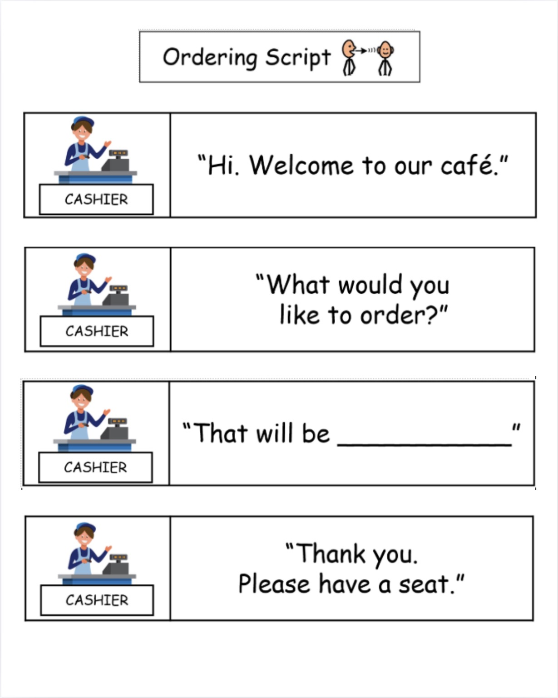  
Figure 7: QR codes of script for customer and cashier (left) and script for cashier obtained from the QR code (right)  
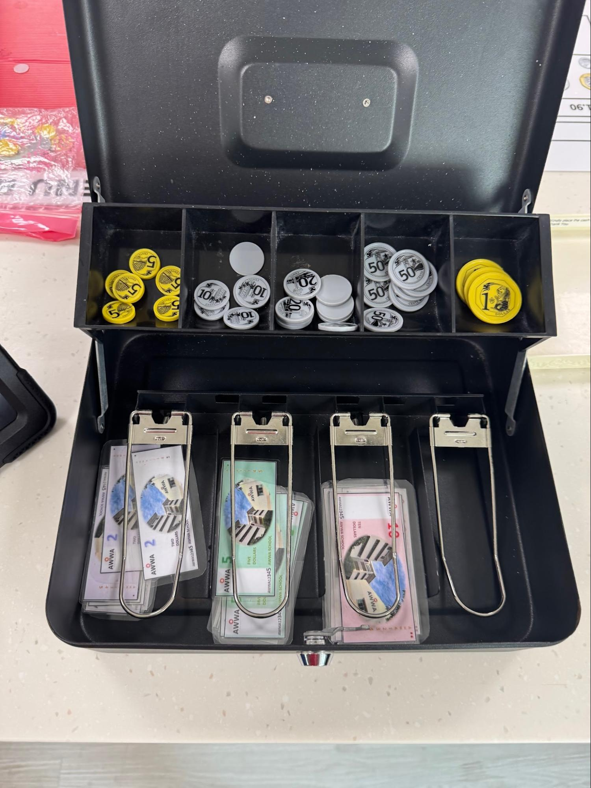  
*Figure 8: Picture of hardware (eg. play money) used at cashier station*

## Appendix B: Job Coach Interview Transcript

Problem-solving-wise, in terms of the hard skill/task itself, that's where we do the teaching. For some of them, sequencing may not be easy because of their learning profile itself, so we have to break down the task for them, show it to them, role-play, and then get them to practice. That is one of the ways.  
If they have problems with their fine motor skills (eg. they have difficulty pouring the drinks) instead, that's where we will work with the OT or PT to see how we can actually close up the gap eg. does the child need an additional tool or need to modify the step so that he or she can do it?

### Feedback on user needs table

**Student needs**

1. Recognising unexpected situations \- To me, as a job coach, I would say recognising unexpected situations is one of the (more critical ones) because now in school, the situations are pretty much predictable for them, but we are also preparing them to go out; Whether it is going out to work or a sheltered workshop, they will definitely come across unexpected situations. So to me, as a job coach, I would think that this is something that is good for them to know and learn, so that when they are out in the community, they know that there are certain situations they may face and how they can problem-solve them. Some of them may ask for help, but some of them will keep quiet and not know what to do next; They may just stall.   
2. Verbalising the problem: So for some of them, (those that can communicate) will go to a teacher and say “I need help”. But even then, if they can communicate to seek help, not all (students) can verbalise and communicate to you that “Hey, I actually need help with this problem.” Like for us, I can come to you and say “Hey, I need help with this coffee machine; There is something wrong, I pressed (the button), but it does not dispense the coffee”. For (AWWA students), they will just say “I need help” as they don't know how to verbalise (the problem).  
3. Transfer strategy to unfamiliar situations \- As sometimes it is a different transferable skill, it may not be straightforward for all students; some of them may not be able to see or generalize that “Hey, this (strategy) can actually be used for a different situation or platform,” so for those with higher ability, cognitively they can understand then they would (recognise that the strategy can be transferred), but usually, even for those high-functioning (students) in our school, we will also teach them to say that this (strategy) can actually be applied to a different subset of skills or different situations.  
4. Generate possible responses \- this could also be applicable, so at least they know that this one problem (does) not just have one problem-solving method; There are actually multiple problem-solving methods that they can use and apply. I think that will make the app more meaningful when they use and learn. So at least they are being exposed to not only one scenario but a certain scenario that will arise when they go out to work.

**Teacher needs**

1. Tracking \- I would say this one. Because if we can use an app, then it will reduce our mental load to record. Bc sometimes, at school itself, we have so many things to record, so if we have an app that lets us just key in (the report) at the end of the day, it makes the work less stressful. Then I would say that this is one of the things that is quite useful. At least it reduces our paperwork.   
2. Adapt \- For some class profiles, (their) learning capability I know can be stretched (and) I know that they can learn a bit more. But for some classes, because of their behavioural and sensorial needs and learning ability, usually I will just go through the basic steps (familiar routine). Probably stretching them (as much as the higher ability students) will cause them to not be able to understand or cope.  
3. Maintenance \- This one definitely.

## Appendix C: Development Platform Evaluation Matrix Scores and Reasonings

Final scores:

| Platform/Tool | Final score / 5 | Percentage |
| :---- | :---- | :---- |
| H5P | 2.75 | 55% |
| GDevelop | 4.50 | 90% |
| Unity | 4.40 | 88% |

Score Reasoning:

#### **C.1 Simulates vocational tasks**

* **H5P (2):** suited to branching scenarios and video, but cannot simulate hands-on actions such as handling coins or tapping items at a counter.  
* **GDevelop (5):** supports everything the cashier task requires in 2D, including tapping, dragging, dialogue and event triggers.  
* **Unity (5):** supports full 2D and 3D simulation, as in ShopAut (Vallefuoco et al., 2022). However, the extra realism of 3D is not needed for this project. Testing of V2 showed that simpler, flashcard-like visuals worked better. GDevelop and Unity are therefore scored equally on this criterion.

#### **C.2 Ease of editing and maintenance**

* **H5P (5):** teachers can create and edit scenarios themselves in Lumi, at no cost and without coding.  
* **GDevelop (3):** the tool can be maintained using GDevelop’s visual event system, and teachers can adjust difficulty through in-game settings. However, teachers cannot change the game itself. GDevelop is free, open source and web-hosted.  
* **Unity (1):** requires C\# coding and a Mac with Xcode to build for iOS, so a programmer would be needed after handover.

#### **C.3 Student performance tracking**

* **H5P (2):** without a learning management system such as Moodle, Lumi’s built-in reporting is limited. AWWA does not use the Singapore Student Learning Space (SLS).  
* **GDevelop (4):** variables can record steps completed, prompts used and breaks taken, and display a teacher summary similar to V2’s. Exporting the data requires additional setup.  
* **Unity (5):** any form of tracking can be built with code.

#### **C.4 Visual and audio prompts**

* **H5P (3):** supports images and audio files, but animation is limited and there is no built-in text-to-speech.  
* **GDevelop (5):** supports animations, flashing arrows and a reviewed text-to-speech extension.  
* **Unity (5):** fully capable of all required prompts.

#### **C.5 Adapts difficulty to student needs**

* **H5P (3):** teachers must keep a separate copy of each scenario for each difficulty level.  
* **GDevelop (5) and Unity (5):** both support a settings screen for adjusting prompt level and the number of choices.

## Appendix D: Prototype V2 Screenshots

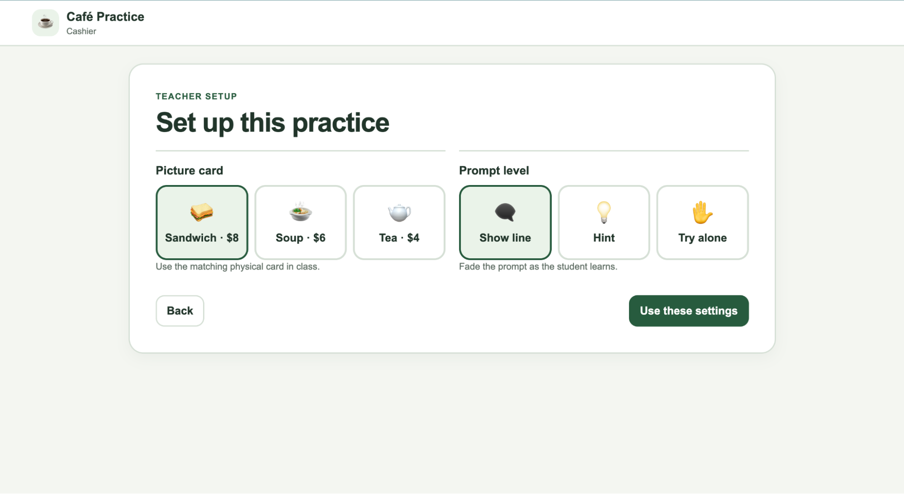

Figure 9: Teacher setup dashboard  
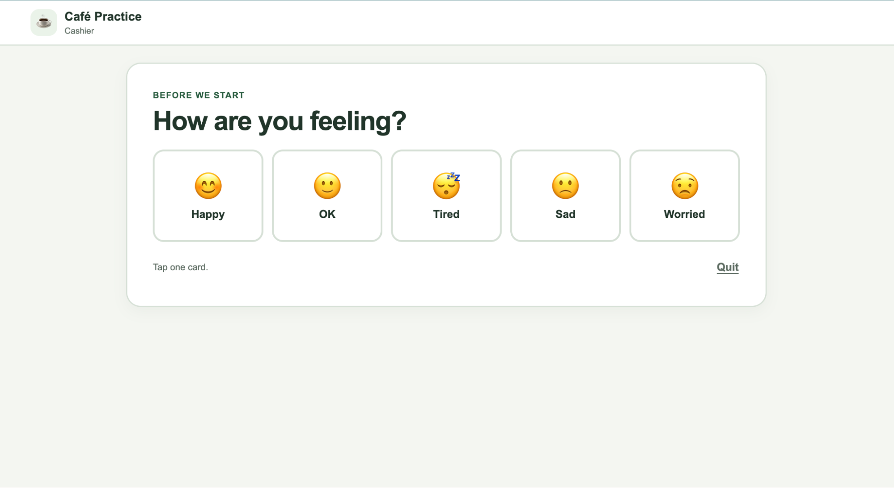  
Figure 10: Check-in interface  
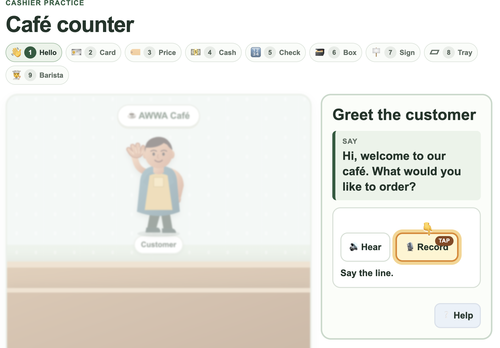  
Figure 11: First step of tutorial featuring voice recording feature  
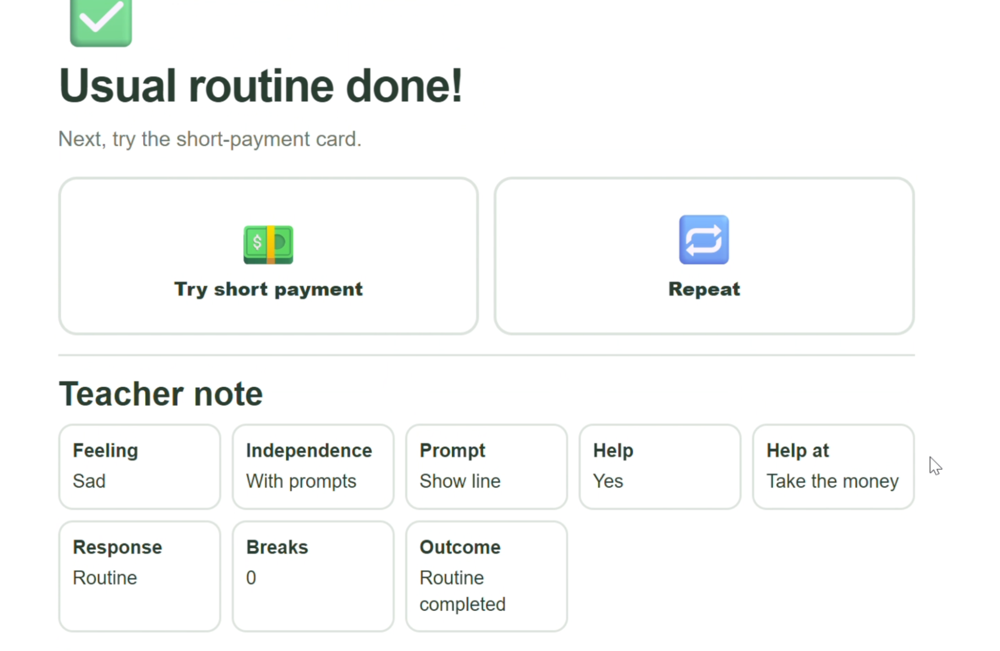  
Figure 12: Summary of session statistics

## Appendix E: Evaluation Plan 

1) #### **Scoring:**

For each of the five steps, record the least support the student needed:

| Score | Level | Example (payment scenario) |
| ----- | ----- | ----- |
| 3 | Independent | Student notices the shortfall unprompted |
| 2 | General prompt | “Is everything okay?” / “What’s different?” |
| 1 | Specific cue | Teacher points to the money and the price |
| 0 | Modelled | Teacher demonstrates the response |

2) **Step completion:**

| Step | What counts as completing it |
| ----- | ----- |
| 1\. Notice | Pauses, looks or signals that something is wrong |
| 2\. Locate | Identifies where the problem is (e.g. the payment) |
| 3\. Choose | Selects an appropriate response option |
| 4\. Communicate | Tells the customer or asks for help, by speech, AAC, pictures or gesture |
| 5\. Check | Confirms the problem is resolved before continuing |
